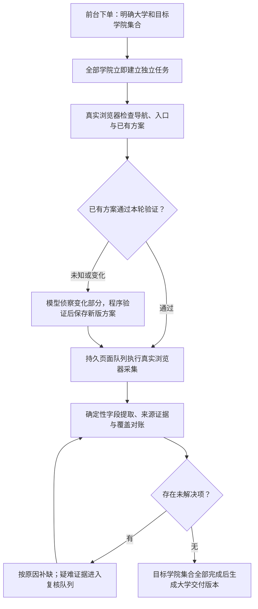

> 历史资料（2026-10-10 标记）：本文保留当时的方案、观察与验证记录，不作为当前工作指令、用户授权或能力验收。现行业务见 [CONTEXT.md](../../CONTEXT.md)，开发任务按 [AGENTS.md](../../AGENTS.md) 分工；使用原结论前核对代码版本、样本与原始证据。

# 教师采集的下一阶段工作方案

日期：2026-09-26。性质：研究与设计建议，未修改生产采集逻辑。外部来源以项目官方文档、作者代码为准；没有运行第三方项目，也没有以其宣传数字作为本项目性能保证。直接教师采集案例另见 [相似案例核查](2026-09-26-faculty-harvest-cases.md)。

## 1. 我的判断

项目的长期目标应是：持续生产可追溯、可更新、能解释覆盖范围的大学教师数据。模型侦察是其中一个步骤。

当前选择“模型判断页面结构与导航、程序直接提取字段”是合理的。此前已验证单学院 89 人和 Token 改善，但尚未形成跨模板验收集；现阶段继续全项目改写的收益不如补齐覆盖账本、断点恢复与经过验证的方案复用。

### 三个需要分开证明的命题

1. **分表正确**：两 Sheet 互斥，合计等于本次已采集且符合口径的教师数。
2. **采集完整**：目标范围内的名录分支、分页、卡片和主页都已有处理结果。
3. **业务正确**：这些人确实属于目标学院的在职专任教师，字段属于本人，简介未遗漏正文。

第一项成立，不能推导后两项成立。当前 `server/browser_batch_tool.py` 的审计明确标记 `coverage_scope=supplied_roster_branches_only`；页面级卡片核对在 `server/harvest_workflow.py`，仍需独立判断最初是否漏发现整个名录。

同构 DOM 能识别重复结构，不能单凭结构证明教师身份。导师目录、医院医生、退休人员、跨学院任职均需要来源资格与任职证据。领域文档中“组织架构叶子人数最高权威”应收敛为交叉核对线索：交叉任职、维护不同步和重复列名都可能导致冲突。是否为零教师单位也不能只依据学院名称认定。

## 2. 推荐工作流

### 第一步：锁定本批次的业务范围

记录目标大学、目标学院集合、在职专任口径和采集时间。如果只提交三所学院，交付范围就是这三所；不能把其结果表述为整所大学全部教师。每个学院立即创建独立任务，维持已授权的全量派发要求。

### 第二步：建立覆盖账本

把“学院入口 → 名录分支 → 分页状态 → 可见卡片 → 候选人 → 个人主页 → 合格记录”保存为可查询的关联记录。每个节点都记录发现来源、快照、完成状态及失败原因。

分页任务不能只以 URL 标识：同 URL AJAX 状态可能对应不同内容。保存交互步骤及卡片内容摘要；队列耗尽之外，还需要明确终页证据。候选人应进入三种结果之一：符合口径、证据明确的排除、待核实。待核实不得被默默当作无邮箱。

每页数量一致只是必要条件，还应检查候选人与卡片来源的对应关系，避免人数正确但错人。不能证明某个入口是否遗漏时，显示覆盖依据和待复核范围，而不是给出伪精确的“100%”。

### 第三步：保存能验证的采集方案

首次遇到网站，由 Harness 完成结构侦察；方案包含实际 URL、卡片选择器、交互方式和验证证据引用，不含教师数据。记录方案版本、适用范围、结构指纹、最近成功时间。

再次采集时，真实浏览器重新检查学院导航、新入口、卡片匹配和分页状态。全部通过才能复用；新增分支、容器变化或选择器失效才触发局部侦察。页面文本与人数变化通常意味着重采数据，不自动意味着旧结构方案失效。

这需要新增“复用方案验证”路径，不能绕过现有本轮证据门禁。缓存结构方案也不等于沿用旧教师数据。

当前 `server/runtime_l1.py` 已有结构指纹与 XPath wrapper 注册表，属于提取器缓存。应在此基础上补充名录覆盖和浏览器交互方案，避免再建立一套重复的低层缓存。`server/agent_recon.py` 目前仍每次执行发现与各分支模型会话。

### 第四步：页面级断点恢复

现有 SQLite 工单租约已解决工单认领；还需要持久保存每个列表、主页或分页状态的执行进度。成功页面与提取结果即时提交，进程恢复时重新检查租约、证据有效期和未完成页面，只重做必要部分。

正常采集仍逐页实际使用 Playwright。已有快照主要支持离线重放、故障分析和算法回归；恢复旧任务时明确快照时间，不把旧数据伪装成本次实时采集。更新任务用当前浏览器内容校验变化，再决定是否重新解析。

### 第五步：按失败原因补缺

| 原因 | 处理 | 是否需要模型 |
| --- | --- | --- |
| 临时超时、连接错误、请求过快 | 针对失败页面等待、退避、重试并保存状态 | 通常不需要 |
| 选择器失效、分页行为改变、新名录入口 | 对出问题的分支重新侦察，重新验证 | 需要结构侦察 |
| 页面已取得，但解析遗漏卡片或正文 | 使用保存的 HTML 离线诊断确定性提取器 | 通常不需要 |
| 同名身份冲突、医院任职资格、OCR 人数无法确认 | 展示本地证据，进入明确的复核状态 | 不让模型生成教师字段 |

当前 `server/agent_worker.py` 的补缺会再执行侦察及整套浏览器计划。按原因与分支缩小恢复范围，能避免一个主页超时就重新浏览整个学院。

### 第六步：大学版本化交付

教师实体、学院任职关系和每次采集记录分别保存。同一个人在两个学院出现，应保留任职关系；大学去重需要足够身份依据，不能仅凭姓名合并，也不能把相同姓名自动视为同一个人。

现有 `server/browser_batch_sync.py` 按学校查询历史已完成工单，汇入大学 Excel。建议增加交付范围与版本：本次请求的学院集合全部完成后才发布完整版本；中间成果标明已完成学院。新采集替换对应学院的当前快照，保留历史记录用于追溯，避免把不同批次、不同时间的教师行无限累加。文件仍以大学命名，历史版本可保存在独立版本目录。

## 3. 可借鉴的一手项目

### academic_census：直接的教师普查案例

2018 年的论文从院系网站构建教师普查，分别处理目录定位、重复条目识别、属性提取，并与人工数据核对。对本项目最有用的是分阶段评估和可重放的页面证据。其英语样本、人工补齐职称、姓名/职称词表和黑名单等限制，详见案例核查；不将历史样本表现外推到中国高校。来源：[论文](https://journals.plos.org/plosone/article?id=10.1371/journal.pone.0202223)、[作者仓库](https://github.com/allisonmorgan/academic_census)。

### Stagehand：成功动作的验证与复用

官方文档介绍本地动作缓存，以及限定观察容器以减少上下文。值得借鉴的是把已成功的浏览器操作变为可复用成果，发生页面变化时重新验证。我们可以继续使用 DeepSeek Harness，自建结构方案缓存；无需引入其模型字段提取或云端数据通道。来源：[官方缓存文档源码](https://github.com/browserbase/stagehand/blob/main/packages/docs/v3/best-practices/caching.mdx)、[作者对缓存校验的说明](https://www.browserbase.com/blog/stagehand-caching)。

### Crawlee：浏览器采集的工程执行层

官方提供 Playwright crawler，存储支持 URL 队列及结果存储，错误处理支持区分可重试错误。适合借鉴页面任务、持久状态和浏览器生命周期管理。采用其设计不要求把现有项目整体迁移，也不能把普通 URL 去重直接用于同 URL AJAX 状态。来源：[Playwright crawler](https://crawlee.dev/python/docs/guides/playwright-crawler)、[存储](https://crawlee.dev/python/docs/guides/storages)、[错误处理](https://crawlee.dev/python/docs/guides/error-handling)。

### Scrapy：任务恢复与状态隔离

`JOBDIR` 保存待处理请求、去重记录和部分抓取状态，各任务目录须隔离；官方也说明干净停止的恢复条件。可学习其状态设计，在我们的 Playwright 执行路径中实现。不能据此退回独立 HTTP 脚本接管工单，也不能宣称其机制天然保证突然断电恢复。来源：[官方任务恢复文档](https://docs.scrapy.org/en/latest/topics/jobs.html)。

### Trafilatura：正文算法的独立评测方法

其官方评测分别衡量正文保留和噪声清除，并提供可复现数据与脚本。可借鉴评测方法，作为现有 MECC 提取器的对照。通用正文工具不能直接证明教师履历完整，列表、表格、论文条目仍须在本项目样本上核对；其现成过滤规则也不应未经审查搬进本项目。来源：[官方评测](https://trafilatura.readthedocs.io/en/latest/evaluation.html)。

### ORCID 与 OpenAlex：身份和任职关系

ORCID 任职工作流给出机构、部门、职务、时间和来源；OpenAlex 作者实体及机构关联来自学术作品。这些适合作为内部实体模型的参考，外部标识可辅助核对。学院名录与论文作者集合是不同口径，不能用它们替代官网在职专任证据或认定学院完整。来源：[ORCID 任职工作流](https://info.orcid.org/documentation/workflows/employment-workflow/)、[OpenAlex 作者定义](https://help.openalex.org/data/authors/)。

## 4. 我建议的实施次序

| 次序 | 工作 | 验收依据 |
| --- | --- | --- |
| 1 | 建立跨网站模板的教师采集验收集，初期建议 10～20 个代表学院 | 人工核对的分支、分页、教师身份、个人邮箱归属和正文块；按大学或模板划分开发与保留验证样本 |
| 2 | 覆盖账本、交付范围与快照版本 | 漏一分支、少一页、错一人、缺一个学院时必须阻断完整交付；重跑不累加旧行 |
| 3 | 页面断点、按错误类型局部恢复 | 中途停止后能接续；普通超时不增加模型侦察；证据过期会重新获取 |
| 4 | 方案缓存与局部侦察 | 重复采集、新增分支、结构改版均有对照；实测模型调用数和整任务 Token，同时检查人数与字段质量 |
| 5 | 浏览器生命周期复用与部署恢复 | 各学院隔离上下文，全部学院仍立即建立独立任务；实例退出可恢复，资源不足和任务状态可见 |

先保留现有 FastAPI、SQLite、Harness 和确定性提取器。只有实际压测说明需要时，才引入新的执行框架或分布式存储。

学院智能体数量、浏览器进程数量和每个官网的访问频率分别衡量；复用浏览器进程可以同时为各学院保留独立上下文。网站返回 429 或资源耗尽时，把退避、资源需求和恢复进度明确显示，避免让所有学院一起反复重试。

## 5. 如何判断改进有效

- **覆盖**：已检查/待检查入口、分页终止证据、卡片未对应项、主页失败项、待复核任职。
- **质量**：验收样本的教师召回与误收、邮箱本人归属、同名误并、正文块遗漏和噪声；不是只有 Excel 人数。
- **成本**：每学院、每分支、每修复轮的真实未缓存输入/缓存输入/输出，以及冷启动与重复采集的模型调用次数；不要预先承诺统一节省比例。
- **交付**：本批目标学院是否全完成，是否混入旧快照，大学唯一身份数与两 Sheet 合计是否一致。
- **运行**：页面重试次数、重启恢复结果、浏览器资源和各学院履约时长分布。

归纳：我推荐把当前已验证的混合采集路径发展为“有覆盖账本、有持久页面任务、有证据的方案复用、有明确交付版本”的系统。新的收益应由跨模板验收与冷/热两类真实采集证明。
