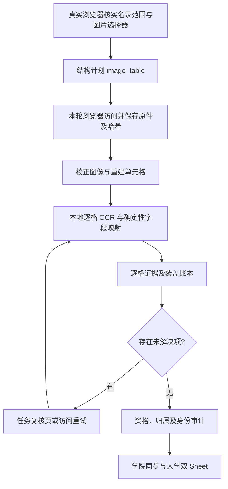
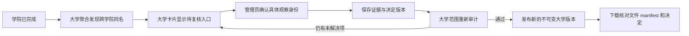

> 历史资料（2026-10-10 标记）：本文保留当时的方案、观察与验证记录，不作为当前工作指令、用户授权或能力验收。现行业务见 [CONTEXT.md](../../../CONTEXT.md)，开发任务按 [AGENTS.md](../../../AGENTS.md) 分工；使用原结论前核对代码版本、样本与原始证据。

# OCR 表格名录适配器与大学级身份复核入口

日期：2026-10-08。状态：**前三步已获批准，两处补正已完成；隔离实现/回归中，未部署**。

本次批准补正：基线为 origin/main 77d7ceb，包含 #12、#15、#16、#17。#12 的 `pdf_roster.table_layout / reconcile_table` 是按列读、折行格、分段序号连续与续表的复用来源。表格名单遵从 CONTEXT.md：各段都收，段标题随行记证据，表格行不作为简介；不按段标题筛人，也不为表格新增“必须逐人证明本院专任”的门禁。沿用分支 source_kind 审核，不能从段标题另立资格口径。仅新增裁决表与 image_table 类型；不改宪法、十列双 Sheet，不部署、不迁移生产库、不重采。

设计阶段遵从“先给方案再动手”，批准后在独立 worktree 实现；生产服务、数据库、采集计划与历史任务未修改。实现与验证范围见 [实施记录](../../implementation/2026-10-08-l1-and-image-table.md)。规范依据为根目录 CONSTITUTION.md、AGENTS.md、CLAUDE.md。

## 1. 建议决策与现状证据

建议新增两个局部模块：确定性的 `image_table_roster` 适配器，以及基于大学交付范围的 `university_identity_review` 模块。继续使用现有真实浏览器、本地 OCR、未解决项、认证与版本发布链路，不增加生产模型入口、不重写提取内核。

实施顺序建议先补 L1，再做表格 OCR：L1 有完整、可隔离的复现；OCR 需先取得两个学校的原图并建立人工核对基准，才能确定结构算法与阈值是否足够。

已核实依据：

- [生产链审计 L1](../../audits/2026-10-01-production-chain-audit.md)：两个学院均 completed，跨学院同名异主页仍阻断大学版本。2026-10-08 重跑 [原复现](../../audits/2026-10-01-production-chain-repro/test_l1_cross_college_homonym.py)，1 passed，实际输出 `blocked None ['homonym_or_distinct_profile']`。
- [`university_delivery._assemble`](../../../server/university_delivery.py) 只收集各工单 `identity_review.audit_pairs` 的许可；没有跨工单裁决来源。冲突目前主要携带 identity_keys，不能直接供人查看完整来源。
- [`app._review_task`](../../../server/app.py) 仅接受 failed 学院任务，而 L1 的学院已 completed；现有 `/review/task/{task_id}` 不能承担大学复核。
- [第二批案例](../../research/case-library/2026-10-01-batch-2.md) 的淮阴地科院是一张职称/学位与姓名分组的扫描表；报告约 90 人，只能作为线索，不能硬编码为验收人数。
- [第三批案例](../../research/case-library/2026-10-02-batch-3.md) 的德州学院文章为表格截图，阅读顺序 OCR 出现行列错位，且有外院教师归属问题。
- [`image_biography.scan_media`](../../../server/image_biography.py) 已返回本地 RapidOCR 的文字框、文本和识别分数，已有原件获取、哈希与人工逐行复核机制；没有单元格拓扑与教师映射。

设计阶段依据保存案例；批准后的实现阶段已用本机真实浏览器取得两个原图，解析仍有未解决项，未人审核数或正式交付，不声称采齐两学校。

## 2. (a) OCR 表格名录适配器

### 2.1 职责与接入位置

适配器负责“浏览器取得的名录原图 → 单元格拓扑 → 带来源的教师观察”，内部处理几何、OCR、表头映射与覆盖审计。调用者只接收 `observations / evidence / coverage / unresolved`；文件落盘和发布仍由现有流程完成。

拟定 Interface：

```python
read_image_table_rosters(
    sources, *, fetch_asset, evidence_dir, ocr_engine, reviews
) -> TableRosterResult
# sources 是捕获模块从本轮 DOM 生成的资源与来源证明，不是模型教师数据。
# ocr_engine / fetch_asset 可注入；缺字段、未知结构和读取失败均返回未解决项。
```

接在 `harvest_workflow.RosterReconciliation` 与 `browser_batch_tool.run_plan` 的媒体名录处理处，与已有 PDF 名录并列。新增 `image_table_sources`，明确分流表格图，避免普通 `reconcile_rosters` 再从图片 alt、导航或整页文本制造姓名候选。



### 2.2 结构计划与模型隔离

新增 branch `kind: "image_table"`，首版只支持已核实的单页图片名录。复用 `card_selector` 选择正文中的表格图片，不新增学校专属脚本。示意如下；实际 URL 与 selector 必须由本轮浏览器核实：

```json
{
  "url": "https://college.example.edu/faculty.htm",
  "kind": "image_table",
  "card_selector": "article img",
  "single_page": true,
  "source_kind": "university_faculty_roster"
}
```

计划不包含姓名、邮箱、表头原文、字段值、逐行转写、模型数出的教师名单，也不让模型填写列的业务含义。图片资源 URL 由采集程序读取本轮 DOM 的 `currentSrc`、链接等实际值；缩略图的原件链接也须来自浏览器实际观察，不能猜路径。

需同步更新 `_validate_plan`、`validate_model_plan`、Schema 字面量白名单、侦察说明、结构验证工具与 `selector_evidence_issues`。浏览器验证只证明 selector 命中正文图片、图片加载完成、尺寸有效、单页导航已核对；**图片数量不是教师数量**。结构验证不会把表格识别结果写回模型计划。

`image_table` 缺少加载或本轮选择器证据时拒绝执行；首版不接受分页、导航子分支或扫描 PDF 表格作为该类型，发现这些形态明确进入未支持项。以后有样本再扩展，不把“单页”当作忽略翻页的开关。

### 2.3 原件、几何与逐格 OCR

1. 用现有浏览器上下文读取已观察的图片原件；保存页面快照、来源 URL、捕获时间、响应类型、原图 SHA-256、宽高。读取失败、图片未加载或实际返回 HTML 必须失败，不能记零人。没有原件的截图降级仅在确认截图覆盖完整图片且可读后采用，并明确记录证据类型。
2. 保留原图。程序做方向校正、倾斜校正和必要的缩放；保存参数与原坐标到处理坐标的变换。用线段、投影和交点重建有线表格，识别缺线与合并格；用文字框对齐进行一致性检查。不得用固定学校像素或“第几列一定是姓名”决定字段。
3. 首版自动接受结构明确的有线表格。无线表、严重透视、缺线导致多个可能拓扑时，保存候选拓扑与 `table_grid_ambiguous`，交人核对；不凭阅读顺序强行展平。结构复核只允许确认已有候选格线、合并格与表头范围，不能一键把整表标成已采齐；没有可验证拓扑就保留阻断。
4. 原图整页 OCR 用于发现未归属文本；裁切单元格后再做本地 OCR 以隔离跨列文字。裁切边距限在格内，避免把邻格抄进来。每个文字框按重叠和中心位置归属；跨格、重复归属、不能归属或裁切前后文本不一致均记录未解决项。识别不一致可做有界本地重试，不能自动挑最顺眼的结果。
5. 字段从确认的单元格原文提取。保存格内换行与文本次序；简介如存在则完整保留，不能摘要或任意截断。OCR 错误由人看原图纠正，原始 OCR 永不覆盖。

沿用现有 RapidOCR 后端；几何实现优先复用环境内已有图像能力。若需增加图像处理依赖，在样本验证后单独列入实现范围，不预先引入另一套云 OCR 或生成模型。

### 2.4 两种教师映射形态

**按记录行排列的表格。** 程序从 OCR 表头及多级表头结构识别字段语义，把行内姓名、职称、邮箱等映射到同一教师。合并职称格只有在拓扑明确证明跨越哪些记录行时才作用于这些行。重复表头按几何和表头结构识别，不能用内容黑名单删行。表头模糊时由人确认格子角色，决定绑定原图、格子和原文。

**按职称/学位分组的姓名矩阵。** 一个格子或一行可能有多人。先确定分组标题与姓名格的物理关联，再按格内文字行、分隔符及现有姓名识别规则生成教师观察。不得对全图文字运行姓氏扫描。每位教师绑定具体格子、文字框和原文片段；标题“博士”作为学位证据保留，不能变成职称。一个连续文字串有多种切分时记录 `table_name_segmentation_ambiguous`；生僻姓或附加同名区分标记不能直接清洗丢弃。

表格式名单沿用 #12 的用户决定：各人员类别段都收，人员类别、段标题、任职等原文随行写入证据，不按段标题排除，也不新增逐人任职门禁；分支 source_kind 的现有审核继续执行。德州材料中的学院关联原文留证，不靠 OCR 擅自改目标学院字段。普通个人详情与医院来源仍按原资格规则处理，纠正文字不会更改那些规则。图片表格与 PDF 表格复用表头列映射、分段序号 1..N、重复表头及续表状态；仅媒体解码与几何取格不同。无简介列的行简介留空，不能把整行表格拼成履历。

邮箱只从本人格/行的范围提取。合并格或表尾邮箱不自动广播给全表；多邮箱、共享邮箱按现有归属门禁处理。不按拼音推测姓名或邮箱。来源没有主页、简介、职称或邮箱时如实缺失，沿用已有字段规则；**空白与识别失败分别记录**，不能把读不出的邮箱写空后当作无邮箱教师放行。没有个人页时主页保持空，来源图片 URL 放证据，不伪造个人主页或用图片 URL 代替。

### 2.5 每个格子的证据与置信度

每个物理格均保存，包括表头、空格、合并格与未识别格。建议审计字段：

```text
cell_id, source_sha256, page/image_index, table_id
row, column, row_span, column_span
polygon_original, polygon_processed, transform_id, crop_sha256
raw_ocr_lines[{text, box, recognition_score}], raw_text, effective_text
confidence{recognition_min, recognition_mean, geometry_score,
           assignment_score, header_mapping_score, policy_version}
state = accepted | verified_empty | unreadable | ambiguous | reviewed
field_role, person_observation_ids, review_revision
```

RapidOCR 的分数是识别分数，不宣称为“正确概率”。没有字符级分数就不制造字符级置信度。逐格保留最低行分数与长度加权均值；几何、归属、表头映射各自评分，不能用平均分盖住关键低分格。结构硬错误不受高 OCR 分数抵消。

分数的可执行定义如下，不留给模型自由打分：

- `recognition_min`：本格所有有效 OCR 行分数的最小值；`recognition_mean`：以原 OCR 文本字符数加权的均值。无有效识别行返回 null；非有限数或缺分数记录未解决项。
- `geometry_score`：格子各外边实测格线支持长度占该边长度的比例，取最小值；同时保存每条边的观测值和合并格候选。该分数只是线段支持度，不能证明缺线处一定是合并格。多个拓扑解释仍为 ambiguous。
- `assignment_score`：每个文字多边形落在所分配格内的面积比例，逐框保留，逐格取最小值；同时保存次候选格的重叠比例。跨边、候选接近或无法唯一归属独立阻断，不能只看主候选高分。
- `header_mapping_score`：由有证据的表头角色与格子关联规则产生，并携带命中的规则与源格；首版只接受唯一映射，唯一为 1、未知/多解为 null 且复核。它表示规则判定状态，不表示语义正确概率。

OCR 自动采信条件是结构唯一、字段归属唯一、识别分数达到已校准的字段阈值且资格/身份审核通过。首批原图在基准验收完成前保持人工核对；不预先给出能自动放行生产数据的固定阈值。

阈值为本地策略配置，按姓名/邮箱/职称/正文分别校准，不由模型或计划设置。实现首版用人工基准逐格校准阈值；两所学校只能验证所见形态，不能据此宣称普遍识别准确率。空格没有文字识别分数，应为 null，另有“已确认空白”证据；有可疑文本区域却无文字输出为 unreadable。

教师字段携带 `cell_ids`、原文及应用了哪些人工决定。复核后的字段标为人工确认，不把原 OCR 分数改成 1.0。

### 2.6 覆盖、未解决项与恢复

保存独立 JSON 证据，不给标准 Excel 增列或增 Sheet。建议产物为原件、格线叠加预览、`table_cells.json`、`table_coverage.json`、`table_review_items.json` 与最终现有审计报告。

覆盖至少证明：

- 已核实的所有图片均已取得；每幅图完整解析，边缘、重复图和多图续表都留有账目。不能仅凭相同姓名认定重复图中的教师相同。
- 每个格子均有状态；每个文字框唯一归属，所有疑似数据格都落在教师、表头/分组、明确非人员结构或未解决项中。无 OCR 框的姓名格/记录行也保留待核对，不能删除。
- 每个人员单元及多人格中的每段姓名都对应观察或未解决项；记录资格排除及其证据。最终人员数按身份审核后的教师计算，不能按行数计算。
- 首批两校须有人对照完整原图核对可见人员单元和总人数，保存绑定原图的核对决定；模型数出的总数不能代替这一基准。数量相等仍须核对人员一一对应，防止“一漏一重”。自动结构证明不足的新形态同样要求全图复核或保持阻断。

新增状态码示例：`table_asset_failed` 归 access；`table_image_selector_unverified` 归 structure；`table_grid_ambiguous`、`table_header_unresolved`、`table_cell_low_confidence`、`table_cell_unreadable`、`table_text_unassigned`、`table_name_segmentation_ambiguous`、`table_person_count_mismatch` 归 review。几何/OCR问题没有导航变化时不反复付费侦察；结构模型只收到状态码、URL、selector 与计数。

每个未解决项至少包含 `status / task_id / page_url / asset_id / source_sha256 / table_id / cell_ids / evidence_ref / recovery_action`；涉及整图的问题允许 cell_ids 为空，但必须定位图片。教师记录不会仅因本格待核而从审计消失：保留暂存观察，未解决项阻断同步与完整发布。

两层账本分别计数：物理格子归属守恒不等于教师人数守恒。先证明所有格子与文字区域有去向，再核对人员单元、多人格切分、资格排除与身份裁决。最终 Excel 人数取确定身份后的合格教师数，原始人员观察数、排除数和待核数另外报告，不强迫它们等于表格行数。

复核入口扩展现有 `/review/task/{task_id}`：左侧完整原图与格线，右侧定位问题格、原 OCR、各项分数及字段归属。授权人可纠正格内文字、确认空白、确认候选结构；不能靠“忽略错误”放行。决定绑定 task、原图 SHA、算法/策略版本、拓扑摘要、格子坐标、原 OCR 摘要、操作者与时间。原件、拓扑或 OCR 变化时决定失效。

复核后复用现有 review-resume、新 attempt 和严格证据携带机制，重新执行确定性解析与全部门禁；本轮浏览器核验及恢复捕获时间语义不变。计划 Schema 更新要升级相关契约/缓存版本，旧不支持计划不得直接命中缓存。

### 2.7 与 poster_reviews 的关系：并存、显式分流

`poster_reviews` 保留为已有整图人工核数证据通路，不由新适配器替代；`image_table` 只处理已核实的表格图片，在进入候选提取和图片对账前分流。一个分支不得同时含表格类型与该 source_url 的 poster_reviews/verified_candidates，混用在计划校验时拒绝。普通图片海报仍走原通路；表格图片由确定性 OCR 产生教师字段，整图人工核数可作为它的独立覆盖证据，但不写进 legacy poster_reviews、不以模型 verified_candidates 录入人名。不得把一张表格图片当一张教师卡，也不得二次经过旧图片名录对账。此次不顺带扩大/修复 legacy IDE 的模型录入通路；生产模型继续拒绝教师字段。

## 3. (b) L1：大学交付范围的身份复核

### 3.1 用户入口与状态

学院仍显示“采集完成”。大学卡片明确显示“大学汇总待身份复核”，给出冲突组数、涉及学院及观察数，不把未核实观察数当教师总人数，也不把 completed 学院改成 failed。

入口挂在**大学卡片/批次大学交付范围**：`/review/university/{scope_id}`。scope 由服务器解析 `batch_id + school + 该范围选中的学院快照`。另可用同一页面显示管理员可见的当前大学快照问题，但本批与当前快照必须分别核对，不能隐式扩大本批学院范围。

页面逐组并排展示原始姓名、学院、主页、职称、邮箱、完整简介与本地来源证据；可折叠长简介，但不删改保存内容。复核项须展示完整同名观察集合，不能只有冲突哈希或两条随机观察。

沿用现有权限：范围拥有者可查看自己有权查看的本批证据；身份裁决仅管理员。涉及其他用户工单的当前快照只给管理员看，普通用户只收到“需管理员复核”与本批状态，不能泄露其他任务记录。

### 3.2 以观察标识裁决，不能以 URL 裁决

现有 `identity_review._resolution` 用 URL 作键，拒绝同 URL 多观察；无主页记录也不能按 URL 区分。大学复核采用独立观察标识：

```text
observation_id = SHA256(task_id, seq, record_digest, source_evidence_digest)
group_id       = SHA256(school, 完整且排序后的观察标识集合)
scope_revision = SHA256(交付范围, 选中的学院快照及其证据摘要)
```

source_evidence_digest 包括可信服务器读取的页面正文/原件哈希和记录定位；未来表格观察再含格子定位。沿用 `record_digest` 的原始收据字段口径，不先规范化学校/学院或改简介再验决定。缺失来源证据须先从可信本地审计恢复，不能只靠两段数据库文本批准身份。

按原始观察生成复核组，再应用决定、合并并规范化导出；不能先静默去重再生成组。沿用现有无冲突、相同个人来源的自动合并口径；L1 不改大学人数或资格规则。无主页跨学院同名保持待复核；同 URL 字段冲突可在相同观察契约下呈现，不借身份决定跳过字段冲突。

一组允许四种明确决定：

1. **不同教师**：所有观察分别保留，形成明确的不同身份；URL 不同本身不是该结论的证明。
2. **同一教师**：全部观察归为一人；必须选择已有观察作为主来源，并确认学院关联及字段冲突。各来源完整简介带来源保留，原记录不覆盖。
3. **按来源分组**：三条及以上观察可分成多个身份，分区须覆盖所有观察、互斥且每组选择成员主来源；不靠零散 pair 白名单推断传递关系。
4. **证据不足**：保存已查看记录与理由，保持 blocked，不自动入队重采或再次侦察。

第一版优先交付“不同教师/证据不足”，直接解除已确认的 L1；同一教师和分组属于同一设计的后续步骤，必须连同字段冲突处理与导出验收一起上线。UI 不先提供尚不能完整验证的选项。

“不同教师”必须保存管理员的证据定位与判定理由，不是勾选即忽略冲突。管理员判断其实为同一人时，首版记录该待处理原因并继续 blocked，不能为取得下载入口而选“不同教师”。“不同教师”也不能消除同一观察自身的职称、邮箱或资格冲突。

### 3.3 同一教师的导出规则

确认不同人时，大学表保留相同姓名的多行。确认同一人时，只改变大学导出副本；保留主观察的姓名/主页，全部来源写入 manifest。简介保留各来源完整原文及来源标记，不能拼成模型总结。

学院十列口径首版沿用主观察学院，manifest 的 `colleges / sources` 保留全部学院关联，页面明确预览。若希望 Excel 学院列改成多学院串，这是另一项导出口径变更，不能在 L1 内顺手改变。

对职称、邮箱等非空冲突，要求管理员逐字段选择有证据的原值；职称仍遵守已定优先级，不能以较低优先级来源覆盖较高优先级明确字段。不同来源的等级无法核实或字段归属存疑则保持待核对。无冲突缺字段可按既有规则补全。长简介超过 Excel 限制沿用现有阻断，不能截断来发布。

### 3.4 决定存储与 Interface

建议在已有 SQLite 新增一张追加式 `university_identity_reviews` 表，不引入独立数据库或通用审批系统。决定保存 `decision_id / revision / school / group_id / scope_revision / evidence / verdict / partition / field_choices / reviewer / reviewed_at / supersedes`。客户端不能指定 reviewer 或本地路径；服务器从认证用户和可信 task/audit 读取。

相较复用工单 JSON，数据库便于大学级并发与记录历史，且不把跨学院许可塞进任何一个学院的审计。保存需短事务和期望 revision；相同内容重复提交幂等，两个管理员提交不同内容则后者返回冲突。修改决定追加新版本，旧决定与旧文件证据保留；撤销也记录原因，不直接删除历史。

模块的 Interface 为“获取指定范围的复核项、保存精确证据决定、把有效决定应用到大学快照”。确定性应用返回 `records / identities / applied_review_certificates / conflicts`，没有证据则继续阻断。复用现有摘要、原文合并及校验规则；不把 `identity_review.audit_pairs` 的工单路径限制放宽为任意全局许可。

拟定路由契约：

- `GET /review/university/{scope_id}`：认证页面，只读；GET 不保存决定也不发布文件。
- `GET /api/university-review/{scope_id}`：返回该范围 revision、待复核组与已应用决定。列表不发全量正文，详细证据按 group 获取；全文保留在本地。
- `GET /api/university-review/{scope_id}/groups/{group_id}`：受同一授权控制的完整组证据。
- `POST /api/university-review/{scope_id}/decisions`：提交 group_id、期望 scope/group revision、判定、完整分区和理由；201 表示新决定，幂等重复返回已有决定。保存并重新审计该范围；不代表 Excel 已发布。
- `POST /api/university-review/{scope_id}/publish`：提交预期 scope 与 review revision，只执行确定性的大学重新审计和发布；返回 blocked 或 ready/版本下载链接。保留既有学校发布锁。

无权限写入为 403，不可见 scope/group 为 404，证据或决定 revision 已变化为 409，分区缺观察/选非成员主来源等请求错误为 422。复用现有认证、CSRF 与服务器路径限定，不能由客户端传 output_dir 或决定文件路径。

### 3.5 重审、版本与下载必须一致



同一个有效裁决读取点须用于 `_assemble / university_snapshot`、`AgentTaskQueue.get_delivery_scope`、状态页面、`publish_delivery` 和 `manifest_snapshot_is_safe`。只在 UI 把 blocked 改成 ready 会产生“页面说成功、下载仍失败”，只改发布则会留下下载绕过。

L1 复核成功不需要修改学院 completed 状态、重领租约或重跑采集。用户在复核页点击“重新审计并发布大学版本”，失败时保留已保存决定和证据，幂等重试发布。

版本摘要必须新增**实际应用的大学级决定 ID/内容摘要、导出身份映射与记录摘要**，不能仍只哈希 `scope + college_snapshots`。相同证据和决定重复发布返回同一版本；改变决定即生成新版本，旧工作簿与 manifest 不覆盖。manifest 保存完整观察来源、适用决定的 revision/摘要及裁决后人数。

发布全过程仍使用已有每校锁；审计读取一致的任务及决定快照，写版本前重新核对 scope/review revision。决定变化或新快照替换时返回 409 重审，不能用过期页面发布。保存决定也遵循兼容的锁顺序，避免在生成 Excel 时长时间持有 tasks.db 写锁。

下载先核实文件自身 manifest：源任务/证据、决定证书、导出映射/摘要与该文件一致；再沿用当前交付范围门禁。不能拿现在的决定重新合并旧观察后，就认定旧 Excel 安全。决定撤销/纠正或源证据变化时相关旧版本 409；未受影响的决定和历史文件继续按原门禁核验。新采集任务不会凭空修好旧文件。

新 manifest 使用显式 schema 版本，包含原始观察摘要、实际应用的决定版本、导出记录摘要及工作簿 SHA-256；证书不能由客户端自行上传放行。历史未含大学级裁决的 manifest 继续走原门禁；缺少新字段不能被解释为“默认已复核”，也不为本功能批量改写旧清单。撤销决定追加记录并使其依赖的版本不可下载，文件和历史决定仍保留。

scope_revision 用于拒绝过期提交；已完成裁决能否复用则逐组核验完整 group_id 与原始证据。无关学院加入不必让一个完全相同的组重新人工判断，但新增同名观察会改变完整组，不能套用旧“这两人不同”推断第三人。历史其它学院冲突与本批限定范围分别审计。

### 3.6 首版改动位置与前台兼容

- `university_identity_review.py`：新模块，封装大学观察组、证据决定及其应用，复用已有字段/摘要辅助函数。
- `agent_queue.py`：增量创建决定表、短事务存储，大学交付范围状态通过同一有效决定读取路径计算。
- `university_delivery.py`：在导出去重前生成原始跨工单观察组；发布与下载审计使用有效决定，决定及导出结果进入版本/manifest。现有无冲突路径继续工作。
- `app.py` 与 `templates/index.html`：增加大学复核页和受权限保护的操作，大学卡片返回 `university_review_url / review_group_count / blocked_reason` 等附加字段；既有 `delivery_scope.state` 仍为 collecting/blocked/ready，不改变学院任务状态枚举。
- 验收测试：从原 L1 的隔离队列复现扩展到页面访问、保存决定、重新发布及下载，不仅检查 `_assemble` 返回值。

大学待复核时沿用停止无意义轮询的行为；管理员保存或发布后页面主动刷新范围状态。失败的字段复核仍在原工单页，完成学院造成的跨学院身份问题进入大学页；两个入口用清楚的提示相互区分，不把所有复核塞进一个任务。

## 4. 验收标准

### 4.1 OCR

- 两个学校原图的人工基准：逐格文本、教师与格子对应、人员总数、姓名/职称分组及资格待核项。保存原件和核对日期，不把旧约数当断言。
- 几何夹具：多级/重复表头、跨行列合并、倾斜、缩放、多人格、换行邮箱、空白格、低分格、外院/非教师行、图边缘文字、多图续表、同名区分标记。
- 漏检、误归属、缺图、识别失败、表头不明及“一漏一重但总数相同”必须阻断；未知无线表明确返回未支持，而非零人成功。
- 人工决定精确生效；改原图、格子拓扑或 OCR 后失效。重跑使用本地证据和原始捕获时间，不调用模型转写。
- 最终两 Sheet 十列、互斥；有邮箱数 + 无邮箱数 = 本交付范围核实后的教师数。没有个人页的人仍在名单内。

### 4.2 L1

- 原复现从“永久 blocked”扩展成完整路径：化学王伟 + 李娜、物理王伟；未裁决 blocked，确认王伟为不同人后 3 人、两行王伟、ready 且真实下载可用。学院仍 completed；无侦察/重采。
- 同名无主页与同 URL 非空字段冲突不能误用 URL 裁决；证据不足仍 blocked。
- 三个同名观察完整分组，不能漏掉任何观察；新增第四条或正文变化使原决定不再适用。
- 下一阶段同人合并两条王伟后应为 2 人，完整简介和两学院关联保留；字段冲突未明确处理时不能发布。
- 只在允许范围查看、管理员裁决；跨用户证据不可泄漏；CSRF、伪造 reviewer、任意文件路径与过期 revision 均拒绝。
- 相同决定幂等；并发不同决定 409；发布中断可重试；决定变化生成新版本，原文件字节不变；撤销决定后相关旧版本下载 409。
- 本批 ready 与当前大学 blocked 能同时如实展示；一个大学 blocked 不阻止同批另一大学 ready 的交付。

合成单测、保存原图回放与实网验收分别报告。测试库和输出隔离，不自动重入队历史失败任务或覆盖已有交付。

## 5. 分步实现范围

1. **L1 最小闭环**：大学观察组与精确证据决定（distinct/insufficient）、SQLite 增量表、大学复核页、状态链接、统一聚合/发布/下载判据、决定进入版本摘要；通过原 L1 端到端扩展。先完成这一项可独立审阅。
2. **OCR 核心**：取得两校原图基准，实现有线表格与姓名分组格、逐格证据/置信度/覆盖输出；先保存页回放，不发布生产大学表。
3. **OCR 生产接入**：升级结构计划契约、本轮图片验证、采集分流、审计/recovery、任务逐格复核与恢复；完成两个样本真实浏览器验收，资格未决仍阻断。
4. **同人/分组裁决扩展（未批准）**：跨学院合并涉及新人数与学院口径，只保留设计备忘，须用户单独拍板；本次不实现、不显示可操作选项。

以上均是拟定范围。没有部署、迁移生产库或重采历史学院的授权推断；这些操作须按后续用户明确范围执行。

## 6. 需要确认的方案选择

供审阅的推荐范围是前三步，按 **L1 最小闭环 → OCR 核心和接入** 顺序实施；第四步“同人/分组裁决扩展”单独确认后安排。首版 OCR 自动支持结构可证明的有线表格；管理员身份裁决权限与双 Sheet/十列口径保持现行规则。

确认点是这份具体设计和实施范围。暂停实现的依据是用户本次明确要求“先给方案再动手”，不是额外增加审批规则。
